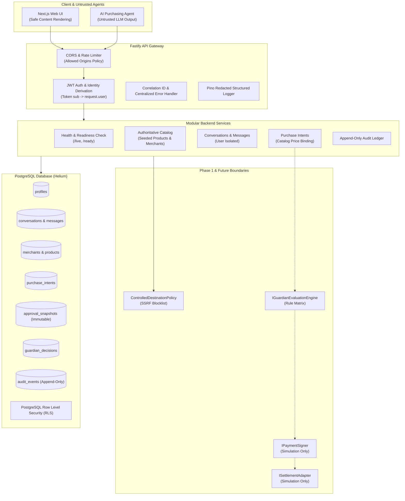

# x402 Guardian — Architecture Specification (Phase 1)

## 1. System Overview

x402 Guardian protects AI-assisted purchases by checking proposed payments against trusted user authorizations before any signing or blockchain settlement occurs.

In modern AI agent ecosystems, language models generate purchase suggestions, invoke tool calls, and interact with merchant APIs. However, models are untrusted entities susceptible to prompt injection, hallucinations, and drainer attacks. x402 Guardian enforces strict cryptographic and domain boundaries so that spending authority remains exclusively with authenticated human users.



---

## 2. Monorepo Structure

The codebase is organized as a pnpm workspace with strict separation between packages and applications:

```
├── packages/
│   ├── shared/            # Shared contracts, domain types, Zod schemas, errors, constants
│   └── database/          # Drizzle ORM schema, SQL migrations, seed scripts, db client
├── apps/
│   ├── api/               # Fastify modular backend API
│   └── web/               # Next.js 14 + Tailwind CSS dashboard UI
├── docs/                  # Architectural and security documentation
└── package.json           # Root workspace configuration
```

---

## 3. Strict Separation: Domain Types vs. x402 Wire Types

A core architectural invariant of x402 Guardian is that **external wire types never directly populate internal database state**.

### Internal Domain Types (`packages/shared/src/types/`)
- `PurchaseIntent`: Represents the draft intent initiated by the user. Amount and recipient are derived strictly from catalog records.
- `ApprovalSnapshot`: Immutable server-side record created only on explicit user approval. Binds user ID, intent ID, product ID, trusted merchant address, exact base-unit amount, network identifier, asset identifier, and approval version.
- `GuardianDecision`: Result of guardian security policy checks (`allow`, `block`, `require_reapproval`).
- `AuditEvent`: Append-only transactional security record.

### x402 Wire Types (`packages/shared/src/types/x402.ts`)
- `X402PaymentRequirement`: The payload returned by an external merchant on HTTP 402 Payment Required.
- `X402ChallengeHeader`: The `X-Payment` header wire payload.
- `X402PaymentAuthorization`: The authorization object returned after guardian evaluation.
- `X402SettlementResult`: Settlement submission status and references.

External merchant requirements are validated, normalized, and reconciled against the trusted catalog before an approval snapshot or signing payload can be constructed.

---

## 4. Trust Boundaries & Security Principles

1. **User Approval is an Authenticated Server-Side Action**
   Spending authority cannot be delegated to an AI model, background cron, or client-side JavaScript. Only a verified user session executing an explicit approval operation may generate an `ApprovalSnapshot`.

2. **Model Output, Merchant Responses, and Product Descriptions are Untrusted**
   AI prompts, tool call responses, and merchant payment requests are treated as untrusted inputs.
   - When a draft purchase intent is created, the price, merchant, asset, network, and recipient address are retrieved **authoritatively from the backend product catalog database**. Any client-supplied amounts or addresses are disregarded.
   - Chat messages are rendered safely without interpreting raw HTML to prevent XSS.

3. **The AI Cannot Grant Spending Authority**
   Language models suggest items or summarize intent, but have zero programmatic ability to approve, sign, or settle payments.

4. **A Guardian Decision Alone is Not an Unrestricted Signing Credential**
   Guardian evaluations verify compatibility and risk rules, but signing requires a valid, active `ApprovalSnapshot` with exact amount and recipient binding.

5. **Red Team Mutation Privileges Exist Only in Isolated Testing**
   Red team attack test suites run in isolated sandboxes and cannot mutate production records.

6. **Simulation Results are Never Represented as Blockchain Settlement**
   Mock signers and settlement adapters produce explicit simulated references (e.g. `SIMULATED_MOCK_SIGNATURE_...`, `sim_settle_...`). No fake hashes (such as `0x...` resembling Ethereum transactions) are ever synthesized.

---

## 5. Database Authorization & RLS Model

### Database Roles & Privilege Structure
- **PostgreSQL Role `postgres` (Superuser)**:
  `postgres` has the attribute `BYPASS RLS`. As verified by our test suite, connections established with administrative credentials bypass database-level RLS policies.
- **Application-Level Ownership Checks**:
  Because backend connection pools frequently connect with application-owner credentials, our Fastify application **always enforces ownership checks at the application query level**:
  ```sql
  -- Every user-scoped query explicitly binds request.user.id
  SELECT * FROM conversations WHERE id = :id AND user_id = :userId;
  SELECT * FROM purchase_intents WHERE user_id = :userId;
  ```
  Elevated backend database privileges therefore cannot bypass tenant isolation.
- **Database Engine RLS Enforcement**:
  RLS policies are established on all user-scoped tables (`profiles`, `conversations`, `messages`, `purchase_intents`, `approval_snapshots`, `guardian_decisions`, `audit_events`).
  For connections using an unprivileged database role (`app_user`), PostgreSQL enforces the session variable:
  ```sql
  CREATE POLICY conversations_select_own ON conversations 
    FOR SELECT USING (user_id = app_user_id());
  ```
- **Append-Only Audit Ledger**:
  The `audit_events` table explicitly revokes `UPDATE` and `DELETE` privileges:
  ```sql
  REVOKE UPDATE, DELETE ON audit_events FROM PUBLIC;
  ```
  *Boundary Note*: While application users cannot modify audit rows, database administrators with superuser access retain technical ability to alter tables. True cryptographic immutability will be complemented by blockchain anchoring in later phases.

---

## 6. Compatibility Matrix & Specification

x402 Guardian adheres to the official x402 draft specification version `draft-v1`.

| Dimension | Supported in Phase 1 | Future Phase Target | Unsupported / Rejected |
| :--- | :--- | :--- | :--- |
| **Specification Version** | `draft-v1` | `v1.0` | `v0.1`, custom variants |
| **Payment Scheme** | `exact-payment-v1` | `streaming-payment-v1`, `subscription-v1` | `arbitrary-transfer` |
| **Networks** | `eip155:84532` (Base Sepolia), `solana:devnet`, `eip155:8453` (Base Mainnet) | Arbitrum, Polygon | Unverified chains |
| **Assets** | `USDC` (6 decimals base units) | `EURC`, `cbBTC` | Floating point tokens, unbacked tokens |
| **Monetary Representation** | `NUMERIC(78, 0)` base-unit integer strings | `NUMERIC(78, 0)` | Floats, IEEE 754 numbers |

---

## 7. Integration Interfaces

Phase 1 provides strict TypeScript interfaces for integration modules:
- [`IMerchantPaymentRequirementService`](file:///home/runner/workspace/packages/shared/src/types/integration.ts#L17)
- [`ControlledDestinationPolicy`](file:///home/runner/workspace/packages/shared/src/types/integration.ts#L10)
- [`IGuardianEvaluationEngine`](file:///home/runner/workspace/packages/shared/src/types/integration.ts#L21)
- [`IPaymentSigner`](file:///home/runner/workspace/packages/shared/src/types/integration.ts#L32)
- [`ISettlementAdapter`](file:///home/runner/workspace/packages/shared/src/types/integration.ts#L37)

Simulation implementations ([`SimulationPaymentSigner`](file:///home/runner/workspace/apps/api/src/modules/integrations/mockSigner.ts#L11) and [`SimulationSettlementAdapter`](file:///home/runner/workspace/apps/api/src/modules/integrations/settlementAdapter.ts#L8)) reject instantiation if `APP_ENV === 'production'`.
