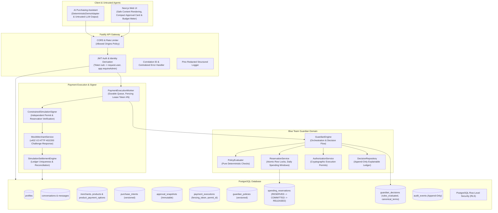
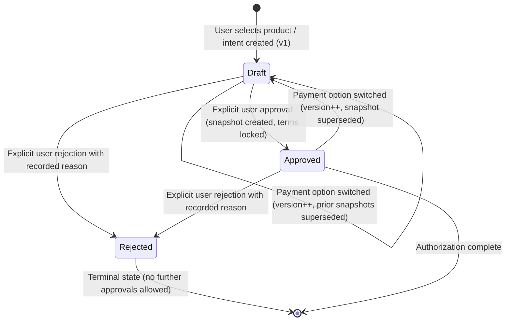
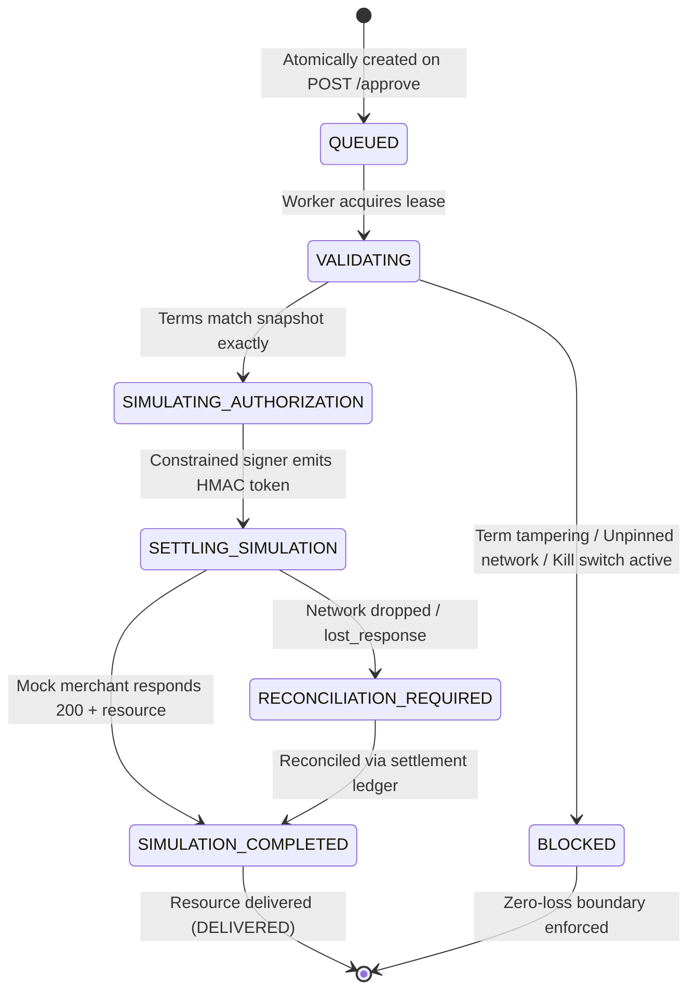

# x402 Guardian — Architecture Specification (Phase 4)

## 1. System Overview

x402 Guardian protects AI-assisted purchases by checking proposed payments against trusted user authorizations and spending policies before any signing or blockchain settlement occurs.

In modern AI agent ecosystems, language models generate purchase suggestions, invoke tool calls, and interact with merchant APIs. However, models are untrusted entities susceptible to prompt injection, hallucinations, and drainer attacks. x402 Guardian enforces strict cryptographic, policy, and domain boundaries so that spending authority remains exclusively with authenticated human users.



---

## 2. Monorepo Structure

The codebase is organized as a pnpm workspace with strict separation between packages and applications:

```
├── packages/
│   ├── shared/            # Shared contracts, domain types, Zod schemas, errors, constants
│   └── database/          # Drizzle ORM schema, SQL migrations, seed scripts, db client
├── apps/
│   ├── api/               # Fastify modular backend API
│   └── web/               # Next.js 14 + Tailwind CSS dashboard UI
├── docs/                  # Architectural and security documentation
└── package.json           # Root workspace configuration
```

---

## 3. Strict Separation: Domain Types vs. x402 Wire Types

A core architectural invariant of x402 Guardian is that **external wire types never directly populate internal database state**.

### Internal Domain Types (`packages/shared/src/types/`)
- `PurchaseIntent`: Represents the draft intent initiated by the user. Amount and recipient are derived strictly from catalog records.
- `ApprovalSnapshot`: Immutable server-side record created only on explicit user approval. Binds user ID, intent ID, product ID, trusted merchant address, exact base-unit amount, network identifier, asset identifier, and approval version.
- `GuardianDecision`: Result of guardian security policy checks (`allow`, `block`, `require_reapproval`).
- `AuditEvent`: Append-only transactional security record.

### x402 Wire Types (`packages/shared/src/types/x402.ts`)
- `X402PaymentRequirement`: The payload returned by an external merchant on HTTP 402 Payment Required.
- `X402ChallengeHeader`: The `X-Payment` header wire payload.
- `X402PaymentAuthorization`: The authorization object returned after guardian evaluation.
- `X402SettlementResult`: Settlement submission status and references.

External merchant requirements are validated, normalized, and reconciled against the trusted catalog before an approval snapshot or signing payload can be constructed.

---

## 4. Trust Boundaries & Security Principles

1. **User Approval is an Authenticated Server-Side Action**
   Spending authority cannot be delegated to an AI model, background cron, or client-side JavaScript. Only a verified user session executing an explicit approval operation may generate an `ApprovalSnapshot`.

2. **Model Output, Merchant Responses, and Product Descriptions are Untrusted**
   AI prompts, tool call responses, and merchant payment requests are treated as untrusted inputs.
   - When a draft purchase intent is created, the price, merchant, asset, network, and recipient address are retrieved **authoritatively from the backend product catalog database**. Any client-supplied amounts or addresses are disregarded.
   - Chat messages are rendered safely without interpreting raw HTML to prevent XSS.

3. **The AI Cannot Grant Spending Authority**
   Language models suggest items or summarize intent, but have zero programmatic ability to approve, sign, or settle payments.

4. **A Guardian Decision Alone is Not an Unrestricted Signing Credential**
   Guardian evaluations verify compatibility and risk rules, but signing requires a valid, active `ApprovalSnapshot` with exact amount and recipient binding.

5. **Red Team Mutation Privileges Exist Only in Isolated Testing**
   Red team attack test suites run in isolated sandboxes and cannot mutate production records.

6. **Simulation Results are Never Represented as Blockchain Settlement**
   Mock signers and settlement adapters produce explicit simulated references (e.g. `SIMULATED_MOCK_SIGNATURE_...`, `sim_settle_...`). No fake hashes (such as `0x...` resembling Ethereum transactions) are ever synthesized.

---

## 5. Database Authorization & RLS Model

### Database Roles & Privilege Structure
- **PostgreSQL Role `postgres` (Superuser)**:
  `postgres` has the attribute `BYPASS RLS`. As verified by our test suite, connections established with administrative credentials bypass database-level RLS policies.
- **Application-Level Ownership Checks**:
  Because backend connection pools frequently connect with application-owner credentials, our Fastify application **always enforces ownership checks at the application query level**:
  ```sql
  -- Every user-scoped query explicitly binds request.user.id
  SELECT * FROM conversations WHERE id = :id AND user_id = :userId;
  SELECT * FROM purchase_intents WHERE user_id = :userId;
  ```
  Elevated backend database privileges therefore cannot bypass tenant isolation.
- **Database Engine RLS Enforcement**:
  RLS policies are established on all user-scoped tables (`profiles`, `conversations`, `messages`, `purchase_intents`, `approval_snapshots`, `guardian_decisions`, `audit_events`).
  For connections using an unprivileged database role (`app_user`), PostgreSQL enforces the session variable:
  ```sql
  CREATE POLICY conversations_select_own ON conversations 
    FOR SELECT USING (user_id = app_user_id());
  ```
- **Append-Only Audit Ledger**:
  The `audit_events` table explicitly revokes `UPDATE` and `DELETE` privileges:
  ```sql
  REVOKE UPDATE, DELETE ON audit_events FROM PUBLIC;
  ```
  *Boundary Note*: While application users cannot modify audit rows, database administrators with superuser access retain technical ability to alter tables. True cryptographic immutability will be complemented by blockchain anchoring in later phases.

---

## 6. Compatibility Matrix & Specification

x402 Guardian adheres strictly to the modern **x402 V2 wire protocol specification** for payment execution.

| Dimension | Supported in Phase 3 Execution | Future Phase Target | Unsupported / Rejected |
| :--- | :--- | :--- | :--- |
| **Specification Version** | `2` (`x402Version: 2`) | Version negotiation | `1`, custom variants |
| **Payment Scheme** | `exact` | `streaming`, `subscription` | `arbitrary-transfer` |
| **Networks** | `eip155:84532` (Base Sepolia - Pinned) | Base Mainnet `eip155:8453`, Solana Devnet `solana:devnet` | Unverified chains (rejected with `UNSUPPORTED_EXECUTION_COMBINATION`) |
| **Assets** | `USDC` (Base Sepolia contract `0x036CbD53842c5426634e7929541eC2318f3dCF7e`) | `EURC`, `cbBTC` | Floating point tokens, unbacked tokens |
| **Monetary Representation** | `NUMERIC(78, 0)` base-unit integer strings (6 decimals) | `NUMERIC(78, 0)` | Floats, IEEE 754 numbers |
| **Wire Transport** | Base64-encoded UTF-8 JSON in `PAYMENT-REQUIRED`, `PAYMENT-SIGNATURE`, `PAYMENT-RESPONSE` | Binary CBOR | Corrupt Base64, payloads > 64KB |

---

## 7. Integration Interfaces

Phase 1 and Phase 3 provide strict TypeScript interfaces for integration modules:
- [`IMerchantPaymentRequirementService`](file:///home/runner/workspace/packages/shared/src/types/integration.ts#L17)
- [`ControlledDestinationPolicy`](file:///home/runner/workspace/packages/shared/src/types/integration.ts#L10)
- [`IGuardianEvaluationEngine`](file:///home/runner/workspace/packages/shared/src/types/integration.ts#L21)
- [`IPaymentSigner`](file:///home/runner/workspace/packages/shared/src/types/integration.ts#L32)
- [`ISettlementAdapter`](file:///home/runner/workspace/packages/shared/src/types/integration.ts#L37)

Simulation implementations ([`SimulationPaymentSigner`](file:///home/runner/workspace/apps/api/src/modules/integrations/mockSigner.ts#L11), [`ConstrainedSimulationSigner`](file:///home/runner/workspace/apps/api/src/modules/payment-engine/constrainedSigner.ts), and [`SimulationSettlementAdapter`](file:///home/runner/workspace/apps/api/src/modules/payment-engine/simulationSettlementAdapter.ts)) reject instantiation and execution if `APP_ENV === 'production'` or if a production network identifier is targeted (`SIGNER_REFUSED_PRODUCTION`).

---

## 8. Phase 2 Purchasing & Approval Lifecycle

In Phase 2, x402 Guardian introduces the interactive purchasing assistant and authoritative approval flow.

### State Transitions


### Assistant Architecture & Live Provider Scope
- **Active Production Default (`DeterministicDemoAdapter`)**:
  The active assistant implementation is [`DeterministicDemoAdapter`](file:///home/runner/workspace/apps/api/src/modules/purchasing-assistant/assistantService.ts#L35). It executes catalog-grounded keyword parsing, numeric/currency budget extraction, conversational reference resolution (e.g. *"the first one"*), and prompt-injection defense locally without external network dependencies.
- **Untested Live Provider Shell (`LiveProviderAdapter`)**:
  [`LiveProviderAdapter`](file:///home/runner/workspace/apps/api/src/modules/purchasing-assistant/assistantService.ts#L219) provides an integration shell with `AbortController` timeouts and bounded fallbacks for optional external LLM services. Because external API keys (`AI_PROVIDER_API_KEY`) are not provided in this offline environment, live-provider network calls are untested and explicitly fall back to `DeterministicDemoAdapter`.
- **Demonstration Merchants & Verification Scope**:
  The seeded merchants (`Cloud Compute Corp`, `Model Host Labs`, `Secure Data API`) are demonstration data fixtures. The database attribute `isTrusted: true` designates demo catalog authorization for test scenarios; it does not constitute real-world legal, financial, or third-party cryptographic verification.

---

## 9. Phase 3 Simulated x402 Payment Engine Architecture

Phase 3 implements an end-to-end, durable, simulated payment execution engine that processes explicit approvals through the x402 V2 protocol lifecycle.

### State Machine Lifecycle


### Engine Subsystems & Security Controls

1. **Pre-Signing Authorization Gate (`authorizationGate.ts`)**:
   - Compares merchant 402 requirements against the server's immutable `approval_snapshots`.
   - Validates user ownership (`snapshot.userId === execution.userId`).
   - Verifies snapshot status is `'active'` and has not expired.
   - Enforces exact string/BigInt match on amount, asset, network, and recipient address.
   - Checks the emergency kill switch status before authorizing any payment.

2. **Constrained Simulation Signer (`constrainedSigner.ts`)**:
   - Generates deterministic simulated authorization IDs (`sim_auth_<uuid>`).
   - Issues server-side HMAC-SHA256 integrity tokens over authorization terms (`${authId}:${network}:${asset}:${amount}:${payTo}`).
   - Contains a hardcoded safety check (`isProductionTarget`) that throws `SIGNER_REFUSED_PRODUCTION` if pointed at production or unpinned networks.
   - Enforces a positive execution allowlist: permits exclusively Base Sepolia (`eip155:84532`) USDC (`0x036CbD53842c5426634e7929541eC2318f3dCF7e` / `USDC`) with `exact` scheme. Rejects production environment (`appEnv === 'production'` or `SIMULATION_MODE === 'false'`).

3. **Controlled Mock Merchant (`mockMerchantService.ts`)**:
   - Implements x402 V2 protocol: returns HTTP 402 with Base64 `PAYMENT-REQUIRED` on unsigned requests, and HTTP 200 with `PAYMENT-RESPONSE` when supplied with a valid `PAYMENT-SIGNATURE`.
   - Supports configurable test fault injection (`corrupt_requirements`, `lost_response`, `delivery_failure`), restricted strictly to automated tests (`process.env.NODE_ENV === 'test'`).

4. **Worker Leases & Stale Worker Concurrency Protection**:
   - Atomic worker lease acquisition via PostgreSQL conditional updates:
     ```sql
     UPDATE payment_executions
     SET worker_id = :workerId, worker_lease_expires_at = NOW() + INTERVAL '30 seconds'
     WHERE id = :id AND (worker_lease_expires_at IS NULL OR worker_lease_expires_at < NOW());
     ```
   - Guards all intermediate state transitions (`updateExecutionWithLease`) by verifying `worker_id` ownership. If a stale worker awakens after lease expiration, subsequent updates fail with `409 Conflict` (`WORKER_LEASE_LOST`), preventing duplicate settlement submissions or state overwrites.
   - Prevents option switching during in-flight states (`VALIDATING`, `SIMULATING_AUTHORIZATION`, `SETTLING_SIMULATION`).

5. **Settlement Ledger & Ambiguous Outcome Reconciliation**:
   - Immutable `settlement_records` table linked directly to payment executions with a unique index on `purchase_intent_id` (`settlement_records_intent_unique_idx`), guaranteeing 1:1 settlement uniqueness per purchase intent.
   - In ambiguous network conditions (`lost_response`), execution halts in `RECONCILIATION_REQUIRED`.
   - Reconcile endpoint (`POST /api/v1/purchases/executions/:id/retry`) queries the persistent settlement ledger and recovers the completed state without duplicate payment.

6. **Paywalled Demonstration Resource Delivery**:
   - Real paywalled payloads seeded in PostgreSQL (`mock_merchant_resources`).
   - Delivers compute credentials, reasoning API tokens, and threat feed bundles upon verified settlement.
   - Delivery failures are distinct from settlement failures; resource delivery retry (`POST /api/v1/purchases/executions/:id/retry`) delivers the resource without re-charging or re-settling.

7. **Administrative Emergency Kill Switch (`killSwitch.ts`)**:
   - Server-verified administrator authorization endpoint (`POST /api/v1/admin/kill-switch` via `app.requireAdmin`, requiring role `admin`) that halts all execution processing across the system with code `KILL_SWITCH_ACTIVE`.
   - Inspection endpoint (`GET /api/v1/admin/kill-switch`) requires authentication.

8. **Historical Approval Execution Boundary**:
   - Historical Phase 2 approvals do not execute automatically behind the user's back.
   - Settle/execution requires a dedicated explicit user request via `POST /api/v1/purchases/intents/:id/execute`. Re-approving an already approved intent remains strictly idempotent without triggering payment.

---

## 9. Phase 4 Blue Team Guardian Architecture

Phase 4 introduces a dedicated, typed Guardian domain that enforces deterministic zero-loss boundaries between user approvals and the simulation signer:

1. **Pure Policy Evaluator (`policyEvaluator.ts`)**:
   - Pure, deterministic evaluation function (`evaluateGuardianPolicy`) with zero side effects.
   - Validates ownership, approval expiration, status, exact parameter equality, pinned network allowlist (`eip155:84532`), pinned asset allowlist (USDC), and exact scheme.
   - Returns explicit `ALLOW` or `BLOCK` outcome, risk score, and detailed rule telemetry.

2. **Atomic Spending Reservations (`reservationService.ts`)**:
   - Manages versioned spending policies with integer limits (`maxAmountPerPayment`, `maxAmountPerTask`, `maxAmountPerDailyWindow`).
   - Concurrency protection: acquires row-level `SELECT ... FOR UPDATE` locks on the user's policy row inside a PostgreSQL transaction.
   - Strict reservation lifecycle: `RESERVED` -> `COMMITTED` -> `RELEASED`.
   - Window accounting: resets daily at `00:00:00 UTC`. Delivery failure or in-flight settlement holds the reservation until reconciled.

3. **Cryptographic Execution Permits (`authorizationService.ts`)**:
   - ALLOW decisions issue an `ExecutionPermit` with a server-side HMAC-SHA256 signature binding the approval snapshot, intent version, amount, recipient, policy version, reservation ID, and worker fencing token.
   - The simulation signer independently validates this HMAC permit before creating authorization signatures. Bare booleans or untrusted decision IDs are rejected.

4. **Worker Lease Fencing Tokens (`paymentExecutionWorker.ts`)**:
   - Increments a monotonically increasing `fencing_token` on each worker lease acquisition.
   - All state mutations require `WHERE id = :id AND fencing_token = :fencingToken`.
   - Superseded or stale workers are aborted with HTTP 409 `STALE_WORKER_FENCING_TOKEN`.

5. **Explainable Decision Persistence (`decisionRepository.ts`)**:
   - Every Guardian evaluation is persisted to an append-only `guardian_decisions` table.
   - Records correlation ID, structured check breakdown (PASS/FAIL per rule), risk score, and canonical terms.
   - Filterable by outcome (`ALL`, `ALLOW`, `BLOCK`) with strict user tenant isolation.

6. **Hardened Administrator Authorization (`auth/index.ts`)**:
   - Profile update endpoints reject client-provided role fields, preventing self-elevation of admin privileges.
   - Administrative endpoints (`PUT /api/v1/admin/guardian/policy`, `POST /api/v1/admin/kill-switch`) require verified server tokens with `role === 'admin'`.
