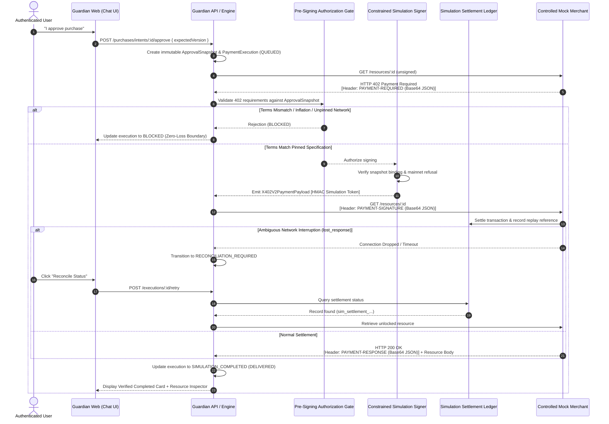

# x402 V2 Protocol Compatibility Specification

**Document Version**: 1.0.0  
**Phase Target**: Phase 3  
**Status**: Authoritative Local Implementation  

---

## 1. Overview & Architecture

The **x402 V2 Protocol** is an open standard designed to enable trustless, machine-negotiated payments for web-accessible resources and APIs. In x402 V2, an HTTP server protecting a paid resource responds to an unauthenticated or unpaid request with an `HTTP 402 Payment Required` status code and a structured `PAYMENT-REQUIRED` challenge header. An AI purchasing assistant or user-agent inspects these terms, obtains user authorization, and returns an `HTTP GET` (or `POST`) containing a `PAYMENT-SIGNATURE` header. Once the server or facilitator verifies settlement, the server returns `HTTP 200 OK` with a `PAYMENT-RESPONSE` header and the unlocked resource payload.

In **x402 Guardian Phase 3**, this entire protocol lifecycle is implemented with production-grade wire transport contracts and schemas, running against a controlled **simulation settlement engine**.



---

## 2. Pinned Phase 3 Execution Combination

To establish a strict, testable boundary and eliminate ambiguity, Phase 3 pins automated payment execution to a single exact combination:

| Parameter | Pinned Value | Description |
| :--- | :--- | :--- |
| **Protocol Version** | `2` (`x402Version: 2`) | Modern x402 V2 specification |
| **Payment Scheme** | `'exact'` | Precise base-unit transfer requirement |
| **Network Identifier** | `'eip155:84532'` | CAIP-2 standard identifier for **Base Sepolia Testnet** |
| **Asset Identifier** | `'USDC'` | Circle USD Coin |
| **Token Contract Address** | `0x036CbD53842c5426634e7929541eC2318f3dCF7e` | Official Base Sepolia USDC contract |
| **Token Decimals** | `6` | 1 USDC = 1,000,000 base units |

### Policy for Alternative Options
The product catalog in PostgreSQL retains demonstration payment options across other networks (e.g. Base Mainnet `eip155:8453` or Solana Devnet `solana:devnet`). Users can select these options to test catalog switching and previewing. However, if a user attempts to execute an unpinned network, the **Authorization Gate** immediately halts execution with:
- `executionStatus`: `'BLOCKED'`
- `failureCode`: `'UNSUPPORTED_EXECUTION_COMBINATION'`
- `failureReason`: `'Pinned Phase 3 payment engine currently only supports Base Sepolia USDC (eip155:84532) exact scheme.'`

---

## 3. Wire Protocol Header Specification

All x402 V2 wire headers are transported as standard HTTP headers containing **Base64-encoded UTF-8 JSON** strings.

### Transport Encoding Rules
1. **Encoding**: `encodeX402Header(payload)` serializes JSON and Base64-encodes the string.
2. **Decoding**: `decodeX402Header(headerValue)` trims whitespace, validates Base64 characters, parses JSON, and performs schema validation.
3. **Payload Threshold**: Maximum header size is strictly enforced at **64 KB** (65,536 bytes) to protect against buffer exhaustion attacks.
4. **Header Names**: Case-insensitive HTTP lookup handles `PAYMENT-REQUIRED`, `Payment-Required`, `payment-required`, etc.

---

### Header 1: `PAYMENT-REQUIRED` (Server -> Client)

Returned by the mock merchant with `HTTP 402`:

```json
{
  "x402Version": 2,
  "resource": {
    "url": "http://127.0.0.1:4000/api/v1/mock-merchant/resources/res_gpu_h100_compute",
    "description": "Dedicated H100 GPU compute access (1 hour cluster lease)",
    "mimeType": "application/json"
  },
  "accepts": [
    {
      "scheme": "exact",
      "network": "eip155:84532",
      "asset": "USDC",
      "amount": "5000000",
      "payTo": "0x71C8364f3B7147a469f3796A775f0aCe374f514C",
      "maxTimeoutSeconds": 900,
      "extra": {
        "tokenContract": "0x036CbD53842c5426634e7929541eC2318f3dCF7e",
        "decimals": 6
      }
    }
  ]
}
```

---

### Header 2: `PAYMENT-SIGNATURE` (Client -> Server)

Supplied by Guardian in the client request header:

```json
{
  "x402Version": 2,
  "scheme": "exact",
  "network": "eip155:84532",
  "payload": {
    "authorizationId": "sim_auth_8b73ad21-d14c-4a30-8902-6e8381274ab3",
    "approvalSnapshotId": "1b089c8a-7cf9-42b7-8d08-a4005b8ef6c4",
    "payer": "0x1111111111111111111111111111111111111111",
    "payTo": "0x71C8364f3B7147a469f3796A775f0aCe374f514C",
    "asset": "USDC",
    "amount": "5000000",
    "nonce": "1730388480000_c931b2",
    "timestamp": "2026-10-31T15:48:00.000Z",
    "simulated": true,
    "integrityToken": "8f3a9e...e72b"
  }
}
```

---

### Header 3: `PAYMENT-RESPONSE` (Server -> Client)

Returned by the mock merchant with `HTTP 200`:

```json
{
  "x402Version": 2,
  "success": true,
  "network": "eip155:84532",
  "transactionHash": "sim_settlement_sim_auth_8b73ad21-d14c-4a30-8902-6e8381274ab3",
  "simulated": true,
  "settledAt": "2026-10-31T15:48:01.250Z"
}
```

---

## 4. Comparison: Specification Wire Protocol vs Simulation Substitutes

To guarantee complete transparency and technical integrity, the following matrix outlines what is full protocol-standard versus what is simulated in Phase 3:

| Dimension | Wire Protocol Standard (RFC/Spec) | Phase 3 Simulation Substitute | Production Transition Path (Phase 4) |
| :--- | :--- | :--- | :--- |
| **HTTP Headers** | `PAYMENT-REQUIRED`, `PAYMENT-SIGNATURE`, `PAYMENT-RESPONSE` | Identical protocol header names and Base64 JSON transport | No change; fully compatible |
| **Payload Schemas** | x402 V2 Zod-validated JSON structures | Identical Zod schemas in `@x402/shared` | No change; fully compatible |
| **Pre-Signing Gate** | Strict authoritative equality checks against snapshot | Identical zero-loss equality verification | No change; security policy persists |
| **Signing Mechanism** | ECDSA / secp256k1 EIP-712 or Solana ed25519 signatures | Server-side HMAC-SHA256 integrity token (`sim_auth_...`) | Replace signer adapter with Web3 wallet / MPC signer |
| **Production Defense** | Reject mainnet unless explicitly configured | Hardcoded refusal: throws `SIGNER_REFUSED_PRODUCTION` on mainnet | Mainnet gating remains enforced |
| **Settlement** | Onchain transaction broadcast or facilitator clearing | PostgreSQL `settlement_records` simulation ledger | Replace with RPC broadcaster / settlement facilitator |
| **Ledger Reference** | Real transaction hash (e.g. `0x3a9f...`) | Deterministic simulated reference `sim_settlement_<authId>` | Parse live transaction hash from onchain receipt |
| **Replay Protection** | Onchain nonce and transaction hash uniqueness | Unique database constraint and idempotency lookup | Utilize onchain nonce and facilitator receipt verification |

---

## 5. Security & Isolation Guarantees

1. **Zero-Loss Verification**: The client never executes a signature unless the merchant's `PAYMENT-REQUIRED` header terms match the user's `approval_snapshots` terms exactly (recipient address, exact amount, network, asset).
2. **Crash & Interruption Safety**: The state machine persists all transitions into PostgreSQL. If a network interruption occurs during settlement, the state is held in `RECONCILIATION_REQUIRED` and recovered without duplicate settlement.
3. **Multi-Tenant Scoping**: All database queries and execution worker commands enforce tenant isolation via `userId` and PostgreSQL Row-Level Security.
